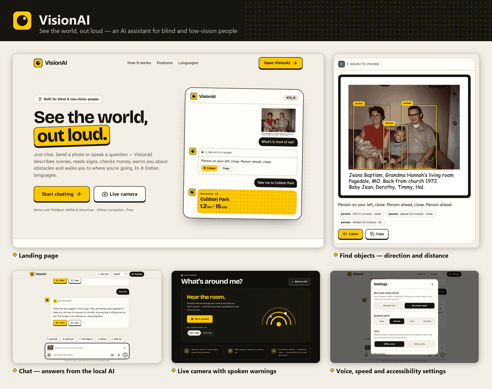

# 👁️ VisionAI — See the world, out loud

An AI assistant for blind and low-vision people. Chat with it, send a photo or point your camera — it describes
scenes, reads signs, checks money, warns you about obstacles and guides your walk, **out loud, in 8 languages**.
It can run **fully offline** on your own computer.

<p align="center">
  
  
  
  
</p>

<p align="center">
  
</p>

## ✨ What it does

- 👁️ **Describe photos** and answer follow-up questions, like a chat
- 📄 **Read text** — signs, labels, medicine — and translate it
- 🚧 **Find obstacles** — *"chair on your left, close"* or *"chair at 10 o'clock"*
- 💵 **Check money** — Indian rupee notes and coins
- 📷 **Live camera** with spoken warnings, distance beeps and vibration
- 🧭 **Walking directions** with turn-by-turn steps

**Languages:** English, हिन्दी, ಕನ್ನಡ, தமிழ், తెలుగు, മലയാളം, मराठी, বাংলা · Works with TalkBack, NVDA and VoiceOver.

## 🚀 Quick start

```bash
git clone https://github.com/LikithGS11/VISIONAI.git && cd VISIONAI
python -m venv venv && venv\Scripts\activate
pip install -r requirements.txt
cd web && npm install && npm run build && cd ..
uvicorn api.main:app
```

Open **<http://localhost:8000>**. Needs Python 3.10+, Node.js 20+ and Tesseract OCR.

**Run it fully offline:** install [Ollama](https://ollama.com) and run `ollama pull gemma3:4b`. Configuration,
offline voices and translation, the API and the project structure are in the **[setup guide](docs/SETUP.md)**.

> VisionAI is a helper, not a replacement — keep using your cane, guide dog or a trusted person for anything safety-critical.

## 👥 Team

**Likith G S** · **Dayana G S** · **Manisha Koli** · **Ananya V**

If this project helped you, leave a ⭐ — together we can make technology more inclusive.
